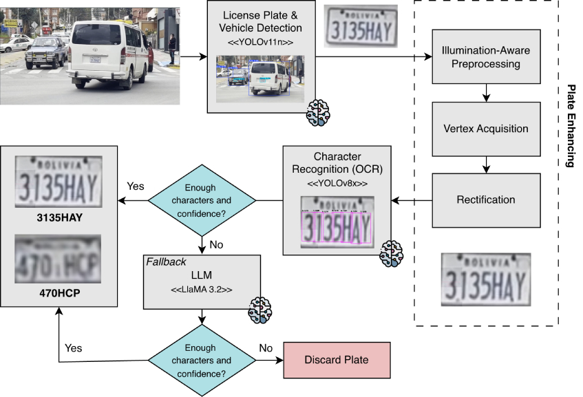

<h1 align="center">BLPR: Robust License Plate Recognition under Viewpoint and Illumination Variations via Confidence-Driven VLM Fallback</h1>


<p align="center">
  <a href="https://doi.org/10.1007/978-3-032-44179-9_28">
    </a>
  <a href="https://arxiv.org/abs/2604.09927">
    </a>
  <a href="#blpr-dataset">
    </a>
  <a href="./LICENSE">
    </a>
</p>

<p align="center">
  A Bolivian license plate detection and recognition framework for real-world viewpoint and illumination variation.
</p>

**Authors:** [Guillermo J. Auza Banegas](https://www.linkedin.com/in/guillermo-a-358247253/), [Diego A. Calvimontes Vera](https://www.linkedin.com/in/calvimontes-diego/), [Natalia L. Condori Peredo](https://www.linkedin.com/in/natalia-condori-864520287/), [Edwin Salcedo](https://www.linkedin.com/in/edwinsalcedo), and [Sergio S. Castro Sandoval](https://www.linkedin.com/in/sergio-castro-sandoval-663a78347/)

## Overview

BLPR is a modular License Plate Detection and Recognition (LPDR) framework designed for Bolivian license plates in unconstrained urban scenes. It targets two major sources of real-world failure: viewpoint distortion and illumination variation.

The system combines a YOLO-based vehicle and plate detector, adaptive geometric rectification, illumination-aware photometric correction, YOLO-based character recognition, and a confidence-triggered Gemma3 4B vision-language model fallback for ambiguous cases. The framework is evaluated on the BLPR dataset suite, the first publicly available Bolivian LPDR dataset for academic research.

The latest preprint reports **89.6% character-level recognition accuracy** on real-world data.

## Contributions

- **BLPR Dataset Suite:** Four datasets covering real street scenes, synthetic Blender renders, balanced OCR training data, and independent real-world validation data.
- **Adaptive Preprocessing:** Geometric rectification and illumination correction are applied only when image-condition cues indicate that they are needed.
- **Confidence-Driven VLM Fallback:** Gemma3 4B is selectively triggered when OCR confidence is low or fewer than six characters are detected.
- **Robustness Evaluation:** Ablations report similarity, precision, recall, F1 score, fallback usage, and latency across viewpoint and illumination conditions.

## Pipeline

<p align="center"></p>

The BLPR pipeline processes each input image as follows:

1. **Vehicle and Plate Detection:** A YOLO26n detector locates cars and plates with a confidence threshold of 0.50. Plate detections are spatially validated against detected vehicles, then cropped with a 10-pixel margin.

2. **Geometric Rectification:** A CLAHE-assisted contour scout estimates plate foreshortening and tilt. A homography is applied when the foreshortening ratio exceeds 1.05 or the tilt exceeds 10 degrees, subject to a 20% width guardrail to avoid severe interpolation artifacts.

3. **Illumination Correction:** The ROI is converted to HSV and the Value channel is analyzed. Correction is skipped when contrast is already sufficient or brightness is balanced; otherwise, dynamic gamma correction is clamped between 0.6 and 1.5.

4. **Character Recognition:** A YOLO26x OCR model detects individual characters at 1024 x 1024 resolution. Non-plate classes such as `BOLIVIA` and separator artifacts are filtered before sorting characters into the final text string.

5. **VLM Fallback:** If fewer than six characters are detected, or if the minimum character confidence falls below 15% of the maximum character confidence, the preprocessed ROI is passed to a local Gemma3 4B model and constrained to return only alphanumeric plate text.

## Installation

```bash
git clone --recursive git@github.com:EdwinTSalcedo/BLPR.git blpr
cd blpr
```

Using `requirements.txt`:

```bash
conda create -n blpr python=3.13
conda activate blpr
pip install -r requirements.txt
```

Using `pyproject.toml`:

```bash
conda create -n blpr python=3.13
conda activate blpr
pip install -e .
```

### VLM Fallback

The fallback sends difficult plate crops to the image-capable Gemma 3 4B model through Ollama. Install Ollama first. On macOS or Linux, use the official installer command or download the macOS app from [ollama.com/download](https://ollama.com/download):

```bash
curl -fsSL https://ollama.com/install.sh | sh
```

On Windows, download Ollama from [ollama.com/download](https://ollama.com/download) or run this in PowerShell:

```powershell
irm https://ollama.com/install.ps1 | iex
```

Start the Ollama service. On macOS or Windows, open the desktop app. On Linux, if the service is not already running, start it in a terminal:

```bash
ollama serve
```

`ollama serve` stays in the foreground, so leave that terminal open and use another terminal to download the model and confirm it is locally available:

```bash
ollama pull gemma3:4b
ollama list
```

`ollama list` should show `gemma3:4b`. Keep the Ollama app or service running while using the pipelines below.

## Inference

`src/test_pipeline.py` runs plate detection, adaptive preprocessing, OCR, and VLM fallback on sample images. It saves annotated copies with plate bounding boxes, recognized text beside each box, and a summary in the top-left corner.

Expected runtime layout:

```text
BLPR/
├── data/
│   ├── pictures/
│   │   ├── labels.csv
│   │   └── <sample_images>
│   ├── videos/
│   │   └── video.mp4
│   └── inference/            # generated outputs, ignored by Git
│       ├── pictures/
│       └── videos/
├── models/
│   ├── best_lpd.pt
│   └── best_lpr.pt
└── src/
    └── test_pipeline.py
```

Run:

```bash
python src/test_pipeline.py
```

The script reads images from `data/pictures/` and recreates `data/inference/pictures/` with the annotated images on each run. It ignores `labels.csv` during inference; performance evaluation reads labels from `data/pictures/labels.csv`. Video inference writes to `data/inference/videos/` and preserves the picture outputs.

Use `--data-dir PATH` and `--output-dir PATH` to select other folders, or `--no-vlm` to run OCR without Gemma.

### Video demo pipeline

The demo uses the same checkpoints as `test_pipeline.py`: `models/best_lpd.pt` for plate detection and `models/best_lpr.pt` for OCR. By default it reads `data/videos/video.mp4` and writes `data/inference/videos/video.mp4`; it creates the output folder automatically. Run:

```bash
python src/demo_pipeline.py --no-preview
```

This disables the live preview window. Omit `--no-preview` to watch inference as it runs. Pass `--input PATH` or `--output PATH` to use different video paths.


## BLPR Dataset

The BLPR dataset suite is designed to support detection, OCR, robustness evaluation, and synthetic-to-real adaptation for Bolivian plates.

| Dataset | Samples | Type | Main Use |
|---------|---------|------|----------|
| BLPR-A | 3,541 | Real street images | Vehicle and plate detection under La Paz street conditions, with car and plate annotations. |
| BLPR-B | 49,392 | Synthetic Blender renders | Viewpoint, illumination, obstruction, and weather variation for detector pretraining. |
| BLPR-C | 520 original / 1,374 balanced / 9,615 augmented | Real and augmented plate crops | Character-level OCR training with class balancing and geometric/noise augmentation. |
| BLPR-D | 503 | Real validation images | Independent evaluation with plate text, lux, distance, and angle metadata. |

Dataset access is intended for academic research through a controlled-access process described by the project materials.

## Results

### Full BLPR Pipeline on BLPR-D

| Pipeline | Average Similarity | Precision | Recall | F1 Score | Time |
|----------|--------------------|-----------|--------|----------|------|
| BLPR | 0.8960 | 0.9102 | 0.8943 | 0.9022 | 402 ms |

The VLM fallback is activated in 34.9% of evaluated cases, allowing the system to retain fast YOLO inference for easier plates while reserving Gemma3 for ambiguous samples.

### Detection

| Model | Precision | Recall | F1 Score | mAP@0.5 | mAP@0.5:0.95 | GFLOPs |
|-------|-----------|--------|----------|---------|---------------|--------|
| YOLO26n | 0.923 | 0.889 | 0.906 | 0.979 | 0.782 | 5.4 |

### OCR

| Model | Dataset | Average Similarity | Precision | Recall | F1 Score | Time |
|-------|---------|--------------------|-----------|--------|----------|------|
| YOLO26x | BLPR-C | 0.9902 | 0.9862 | 0.9948 | 0.9904 | 18 ms |
| YOLO26x | BLPR-D | 0.7266 | 0.9128 | 0.7132 | 0.8008 | 18 ms |

### Robustness Highlights

| Condition | Raw F1 | BLPR F1 | Main Effect |
|-----------|--------|---------|-------------|
| Steep viewpoint | 0.5412 | 0.8807 | Selective rectification plus fallback substantially improves severe perspective cases. |
| Low light | 0.5291 | 0.8915 | Photometric routing plus fallback improves difficult illumination cases. |
| Tilted viewpoint | 0.9327 | 0.9413 | BLPR improves accuracy while avoiding unnecessary preprocessing. |

### Zero-Shot Cross-Domain Evaluation

| Dataset | Average Similarity | Precision |
|---------|--------------------|-----------|
| SSIG-SegPlate | 0.7749 | 0.8139 |
| UFPR-ALPR | 0.7693 | 0.8097 |
| RodoSol-ALPR | 0.7516 | 0.8228 |
| BLPR-D | 0.8960 | 0.9102 |

### Reproducing the performance evaluation

`src/evaluate_performance.py` prints the evaluation tables and ablation analysis by comparing predictions with ground-truth plate text:

```bash
python src/evaluate_performance.py
```

The CSV and referenced images must be in the same folder. The CSV uses `imagen`, `plate1` through `plate5`, `distance1` through `distance5`, and `angle` for the evaluation. Use `--data-dir PATH` to evaluate another labeled dataset.

## Project Structure

```text
BLPR/
├── .gitignore
├── README.md
├── TODO.md
├── LICENSE
├── pyproject.toml
├── requirements.txt
├── uv.lock
├── data/                         # local data, ignored by Git
│   ├── pictures/                 # sample images and labels.csv
│   ├── videos/
│   │   └── video.mp4
│   └── inference/                # generated outputs, ignored by Git
│       ├── pictures/             # annotated sample images
│       └── videos/
│           └── video.mp4         # annotated video
├── docs/                         # paper source and supporting assets
├── images/
│   └── pipeline.jpg
├── models/
│   ├── best_lpd.pt
│   └── best_lpr.pt
└── src/
    ├── blpr_pipeline.py
    ├── evaluate_performance.py
    ├── test_pipeline.py
    └── demo_pipeline.py
```

## Citation

If you find this work useful, please cite:

```bibtex
@inproceedings{AuzaBanegas2027BLPR,
  title     = {BLPR: Robust License Plate Recognition Under Viewpoint and Illumination Variations via Confidence-Driven VLM Fallback},
  author    = {Auza Banegas, Guillermo J. and others},
  booktitle = {Advances in Soft Computing},
  series    = {Lecture Notes in Computer Science},
  publisher = {Springer},
  year      = {2027},
  doi       = {10.1007/978-3-032-44179-9_28}
}
```
