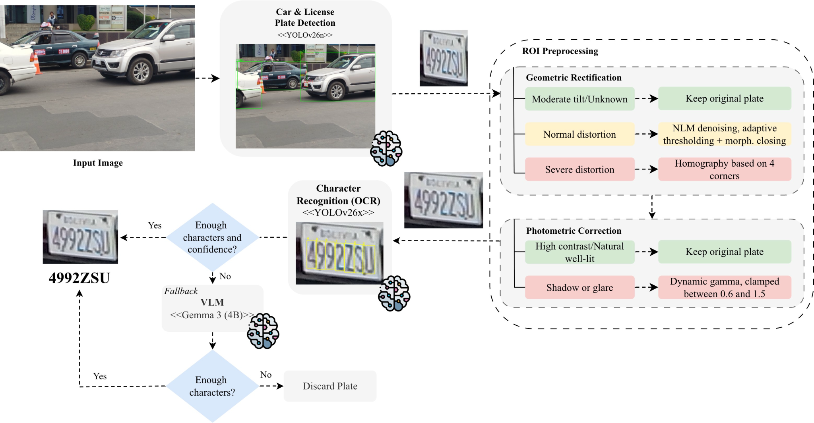
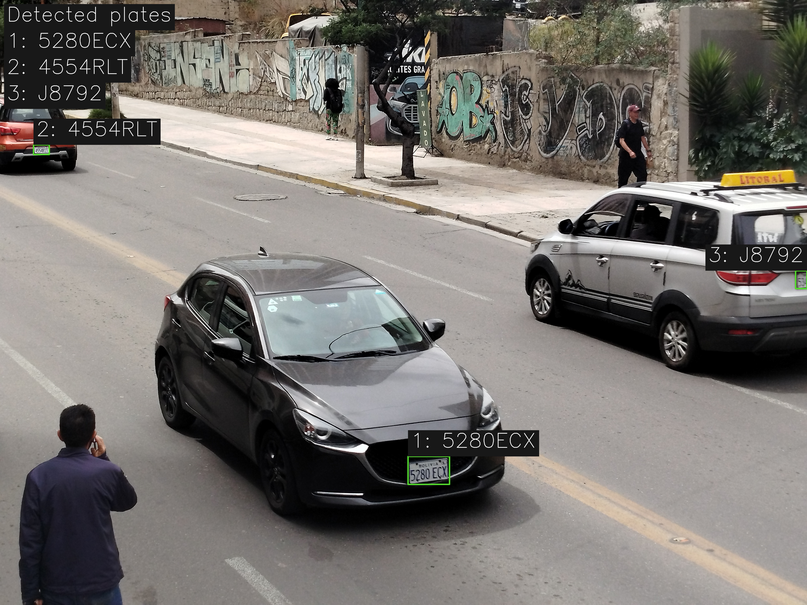
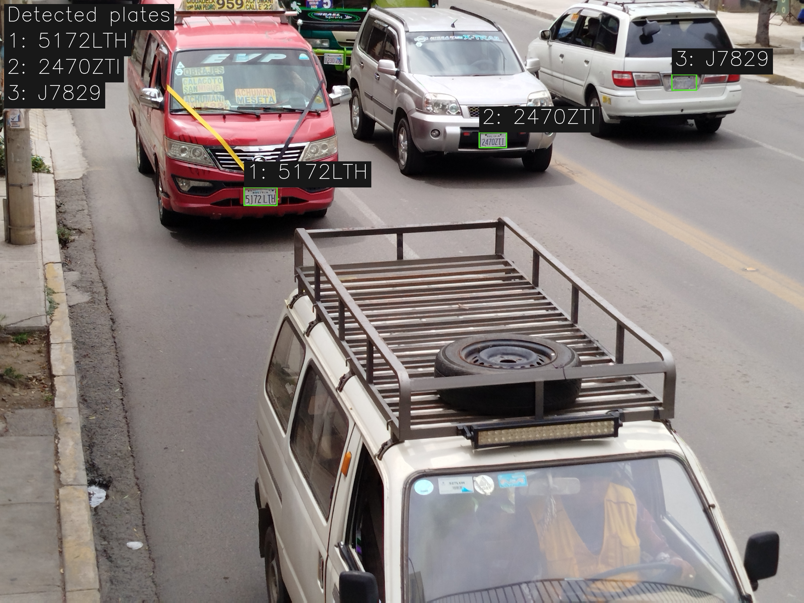
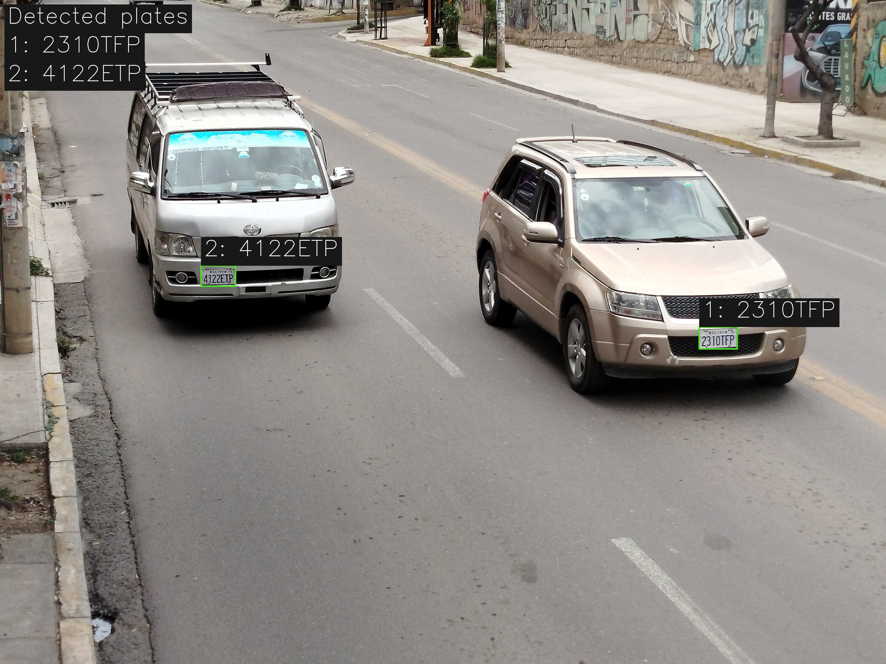

<h1 align="center">BLPR: Robust License Plate Recognition under Viewpoint and Illumination Variations via Confidence-Driven VLM Fallback</h1>

<p align="center">
  <a href="https://doi.org/10.1007/978-3-032-44179-9_28"></a>
  <a href="https://arxiv.org/abs/2604.09927"></a>
  <a href="#blpr-dataset"></a>
  <a href="./LICENSE"></a>
</p>

**Authors:** [Guillermo J. Auza Banegas](https://www.linkedin.com/in/guillermo-a-358247253/), [Diego A. Calvimontes Vera](https://www.linkedin.com/in/calvimontes-diego/), [Natalia L. Condori Peredo](https://www.linkedin.com/in/natalia-condori-864520287/), [Edwin Salcedo](https://www.linkedin.com/in/edwinsalcedo), and [Sergio S. Castro Sandoval](https://www.linkedin.com/in/sergio-castro-sandoval-663a78347/)


> 🎉🎉🎉 Our paper was presented at the 25th Mexican International Conference on Artificial Intelligence (MICAI), held in Chihuahua, Mexico 🇲🇽, from 2–6 November 2026.

<p align="center"></p>

<div align="center">
<a href="#overview">Overview</a> | <a href="#pipeline">Pipeline</a> | <a href="#installation">Installation</a> | <a href="#inference">Inference</a> | <a href="#blpr-dataset">Dataset</a> | <a href="#results">Results</a> | <a href="#demo">Demo</a>
</div>


## Overview

**BLPR** is a modular License Plate Detection and Recognition (LPDR) framework for Bolivian license plates in unconstrained urban environments, BLPR addresses two major challenges in real-world recognition: viewpoint distortion and illumination variation. The framework integrates YOLO-based vehicle and license plate detection, adaptive geometric rectification, illumination-aware photometric correction, YOLO-based character recognition, and a confidence-driven Gemma 3 4B vision-language model (VLM) fallback for ambiguous cases. It is evaluated on the BLPR dataset suite, the first Bolivian LPDR dataset developed for academic research, providing an open-source foundation for further research and practical applications.

### Contributions

- **BLPR Dataset Suite:** Four datasets spanning real street scenes, synthetic renders, balanced OCR training, and independent real-world validation.
- **Condition-Aware OCR Pipeline:** Combines selective image correction with confidence-triggered VLM fallback.
- **Robustness Evaluation:** Ablations across viewpoint and illumination conditions, measuring recognition performance, fallback usage, and latency.

## Pipeline

The BLPR pipeline consists of five steps:

1. **Vehicle and Plate Detection:** A YOLO26n detector locates cars and plates with a confidence threshold of 0.50. Plate detections are spatially validated against detected vehicles, then cropped with a 10-pixel margin.

2. **Geometric Rectification:** A CLAHE-assisted contour scout estimates plate foreshortening and tilt. A homography is applied when the foreshortening ratio exceeds 1.20 or the tilt exceeds 12.5 degrees, subject to a 30% width guardrail. Low-distortion plates use denoising and morphological processing, while moderate cases are left unchanged.

3. **Illumination Correction:** The ROI is converted to HSV and the Value channel is analyzed. Correction is skipped when contrast exceeds 40 or mean brightness is between 80 and 160; otherwise, dynamic gamma correction is clamped between 0.7 and 1.4.

4. **Character Recognition:** A YOLO26x OCR model detects individual characters at 1024 × 1024 resolution. The `BOLIVIA` and separator classes are filtered out, characters are sorted into lines, and the upper-right department code is excluded from the final text.

5. **VLM Fallback:** If fewer than six characters are detected, or if the lowest character confidence is less than 15% of the highest, the preprocessed ROI is passed to a local Gemma3 4B model, which returns only the plate’s alphanumeric text.

## Installation

```bash
git clone --recursive git@github.com:EdwinTSalcedo/BLPR.git blpr
cd blpr
```

Using `requirements.txt`:

```bash
conda create -n blpr python=3.13
conda activate blpr
pip install -r requirements.txt
```

Using `pyproject.toml`:

```bash
conda create -n blpr python=3.13
conda activate blpr
pip install -e .
```

### VLM Fallback

The fallback sends difficult plate crops to the image-capable Gemma 3 4B model through Ollama. Install Ollama first. On macOS or Linux, use the official installer command or download the macOS app from [ollama.com/download](https://ollama.com/download):

```bash
curl -fsSL https://ollama.com/install.sh | sh
```

On Windows, download Ollama from [ollama.com/download](https://ollama.com/download) or run this in PowerShell:

```powershell
irm https://ollama.com/install.ps1 | iex
```

Start the Ollama service. On macOS or Windows, open the desktop app. On Linux, if the service is not already running, start it in a terminal:

```bash
ollama serve
```

`ollama serve` stays in the foreground, so leave that terminal open and use another terminal to download the model and confirm it is locally available:

```bash
ollama pull gemma3:4b
ollama list
```

`ollama list` should show `gemma3:4b`. Keep the Ollama app or service running while using the pipelines below.

## Inference

`src/test_pipeline.py` runs plate detection, adaptive preprocessing, OCR, and VLM fallback on sample images. It saves annotated copies with plate bounding boxes, recognized text beside each box, and a summary in the top-left corner.

Expected runtime layout:

```text
BLPR/
├── assets/
│   ├── pictures/
│   │   ├── labels.csv
│   │   └── <sample_images>
│   ├── videos/
│   │   └── video.mp4
│   └── inference/            # generated outputs, ignored by Git
│       ├── pictures/
│       └── videos/
├── models/
│   ├── best_lpd.pt
│   └── best_lpr.pt
└── src/
    └── test_pipeline.py
```

Run:

```bash
python src/test_pipeline.py
```

The script reads images from `assets/pictures/` and recreates `assets/inference/pictures/` with the annotated images on each run. It ignores `labels.csv` during inference; performance evaluation reads labels from `assets/pictures/labels.csv`. Video inference writes to `assets/inference/videos/` and preserves the picture outputs.

Use `--data-dir PATH` and `--output-dir PATH` to select other folders, or `--no-vlm` to run OCR without Gemma.

### Video demo pipeline

The demo uses the same checkpoints as `test_pipeline.py`: `models/best_lpd.pt` for plate detection and `models/best_lpr.pt` for OCR. By default it reads `assets/videos/video.mp4` and writes `assets/inference/videos/video.mp4`; it creates the output folder automatically. Run:

```bash
python src/demo_pipeline.py --no-preview
```

This disables the live preview window. Omit `--no-preview` to watch inference as it runs. Pass `--input PATH` or `--output PATH` to use different video paths.


## BLPR Dataset

The BLPR dataset suite is designed to support detection, OCR, robustness evaluation, and synthetic-to-real adaptation for Bolivian plates.

| Dataset | Samples | Type | Main Use |
|---------|---------|------|----------|
| BLPR-A | 3,541 | Real street images | Vehicle and plate detection under La Paz street conditions, with car and plate annotations. |
| BLPR-B | 49,392 | Synthetic Blender renders | Viewpoint, illumination, obstruction, and weather variation for detector pretraining. |
| BLPR-C | 520 original / 1,374 balanced / 9,615 augmented | Real and augmented plate crops | Character-level OCR training with class balancing and geometric/noise augmentation. |
| BLPR-D | 727 | Real street images | Calibration and held-out evaluation subsets with plate text; held-out data includes lux, distance, and angle metadata. |

## How to obtain the dataset

The BLPR dataset is released for academic research only and is free to researchers from educational or research institutes for **non-commercial purposes**.

To be able to download the dataset, please read carefully [**this license agreement**](./license-agreement.pdf), fill it out, and send it back to the first author ([e.r.salcedoaliaga@qmul.ac.uk](mailto:e.r.salcedoaliaga@qmul.ac.uk)). **Your e-mail must be sent from a valid university account** (.edu, .ac or similar).

In general, you will receive a download link within 1-5 business days. If you do not receive it within this timeframe, please check your spam/junk folder. Failure to follow the instructions above may result in no response.

## Results

The results below cover end-to-end recognition, detection and OCR performance, robustness under challenging conditions, and zero-shot evaluation across datasets.

### End-to-End Recognition on BLPR-D

On the 470-instance held-out BLPR-D evaluation set, the full pipeline achieved the results below. Plates marked “Far” were excluded. Values are reported as the mean ± standard deviation over 10 trials.

| Pipeline | Average Levenshtein Similarity | Precision | Recall | F1 Score | Time |
|----------|--------------------|-----------|--------|----------|------|
| BLPR (Ours) | 0.8951 ± 0.0010 | 0.9087 ± 0.0015 | 0.8935 ± 0.0010 | 0.9010 ± 0.0011 | 253.6 ± 0.002 ms |

The Gemma3 fallback was activated in 34.7% of cases, handling plates flagged as ambiguous by the OCR system.

### Plate Detection on BLPR-A

On BLPR-A, the YOLO26n detector achieved the following results:

| Model | Precision | Recall | F1 Score | mAP@0.5 | mAP@0.5:0.95 | GFLOPs |
|-------|-----------|--------|----------|---------|---------------|--------|
| YOLO26n | 0.923 | 0.889 | 0.906 | 0.979 | 0.782 | 5.4 |

### OCR Performance

YOLO26x was evaluated on the BLPR-C test set and the BLPR-D calibration set:

| Model | Dataset | Average Levenshtein Similarity | Precision | Recall | F1 Score | Time |
|-------|---------|--------------------|-----------|--------|----------|------|
| YOLO26x | BLPR-C test | 0.9902 | 0.9862 | 0.9948 | 0.9904 | 18 ms |
| YOLO26x | BLPR-D calibration | 0.8046 | 0.9344 | 0.8039 | 0.8642 | 18 ms |

### Robustness Under Challenging Conditions

BLPR improves F1 in all three conditions shown below, with the largest gains under steep viewpoints and low light.

| Condition | Raw F1 | BLPR F1 | Main Effect |
|-----------|--------|---------|-------------|
| Steep viewpoint | 0.5412 | 0.8860 | Selective rectification and fallback improve recognition under severe perspective distortion. |
| Low light | 0.5291 | 0.8928 | Photometric correction and fallback improve recognition in low-light conditions. |
| Tilted viewpoint | 0.9324 | 0.9374 | BLPR gives a smaller improvement while avoiding unnecessary preprocessing. |

### Zero-Shot Cross-Domain Evaluation

The table reports zero-shot performance across the listed datasets:

| Dataset | Average Levenshtein Similarity | Precision |
|---------|--------------------|-----------|
| SSIG-SegPlate | 0.7796 | 0.7938 |
| UFPR-ALPR | 0.7827 | 0.8752 |
| AOLP | 0.8425 | 0.9569 |
| RodoSol-ALPR | 0.7028 | 0.8389 |
| BLPR-D | 0.8960 | 0.9102 |

### Reproducing the Evaluation

Run `src/evaluate_performance.py` to compare predictions with ground-truth plate text and print the evaluation tables and ablation analysis:

```bash
python src/evaluate_performance.py
```

Place the CSV and all referenced images in the same folder. The CSV must contain `imagen`, `plate1` through `plate5`, `distance1` through `distance5`, and `angle`. To evaluate another labeled dataset, pass its folder with `--data-dir PATH`.

## Project Structure

```text
BLPR/
├── .gitignore
├── README.md
├── TODO.md
├── LICENSE
├── license-agreement.pdf
├── pyproject.toml
├── requirements.txt
├── uv.lock
├── assets/
│   ├── animation/
│   │   └── pipeline-animated.svg
│   ├── demo/                     # optimized inference examples shown below
│   │   ├── IMG_20251111_135553.jpg
│   │   ├── IMG_20251111_134644.jpg
│   │   └── IMG_20251111_134513.jpg
│   ├── pictures/                 # sample images and labels.csv
│   ├── videos/                   # input videos
│   │   └── video.mp4
│   └── inference/                # generated outputs, ignored by Git
│       ├── pictures/             # annotated sample images
│       └── videos/
│           └── video.mp4         # annotated video
├── docs/                         # local paper files, ignored by Git
├── scripts/
│   ├── animate_pipeline.py
│   ├── pipeline.jpg
│   └── face_anonymisation/       # face anonymization and BLPR-D release tools
├── models/
│   ├── best_lpd.pt
│   └── best_lpr.pt
└── src/
    ├── blpr_pipeline.py
    ├── evaluate_performance.py
    ├── test_pipeline.py
    └── demo_pipeline.py
```

## Demo

The images below show three example outputs from the BLPR inference pipeline.

<table>
  <tr>
    <td></td>
    <td></td>
    <td></td>
  </tr>
</table>

## License

The [License](./LICENSE) covers the project materials, including code, model weights, documentation, and images. It permits non-commercial academic research and education and requires citation of the
paper for every reuse. The BLPR datasets are also subject to the separate
[dataset agreement](./license-agreement.pdf).

## Citation

If you find BLPR useful for your project, cite:

```bibtex
@inproceedings{AuzaBanegas2027BLPR,
  title     = {BLPR: Robust License Plate Recognition Under Viewpoint and Illumination Variations via Confidence-Driven VLM Fallback},
  author    = {Auza Banegas, Guillermo J. and Calvimontes Vera, Diego A. and Condori Peredo, Natalia L. and Salcedo, Edwin and Castro Sandoval, Sergio S.},
  booktitle = {MICAI 2026},
  series    = {Lecture Notes in Artificial Intelligence},
  volume    = {17150},
  pages     = {458--484},
  publisher = {Springer},
  year      = {2027},
  doi       = {10.1007/978-3-032-44179-9_28}
}
```
